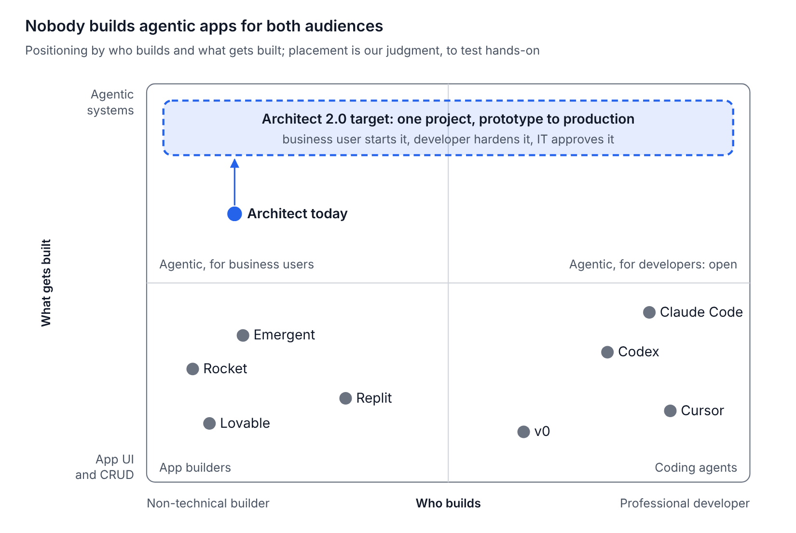
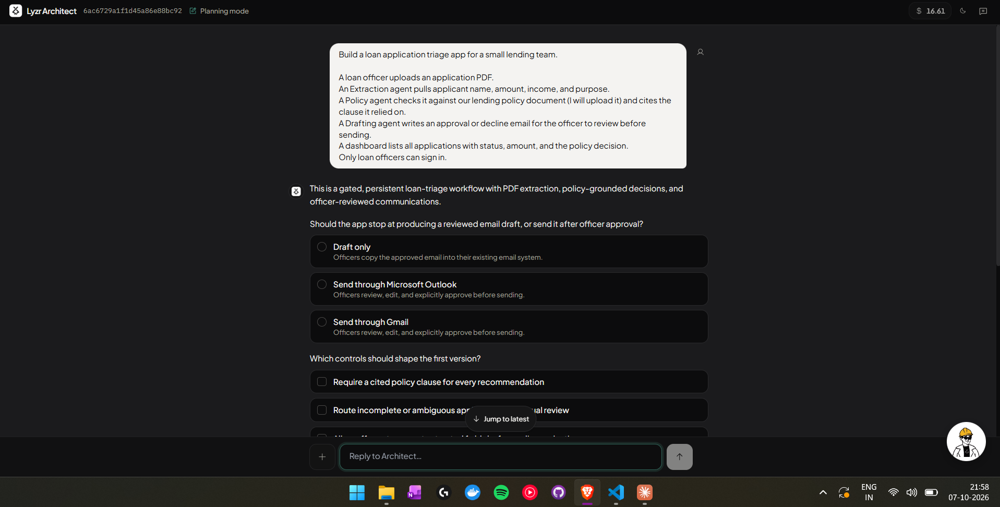
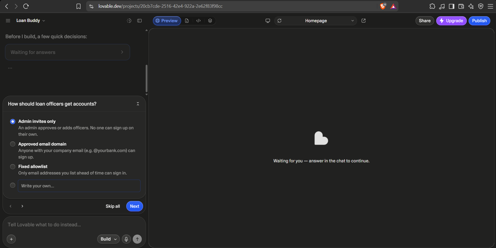
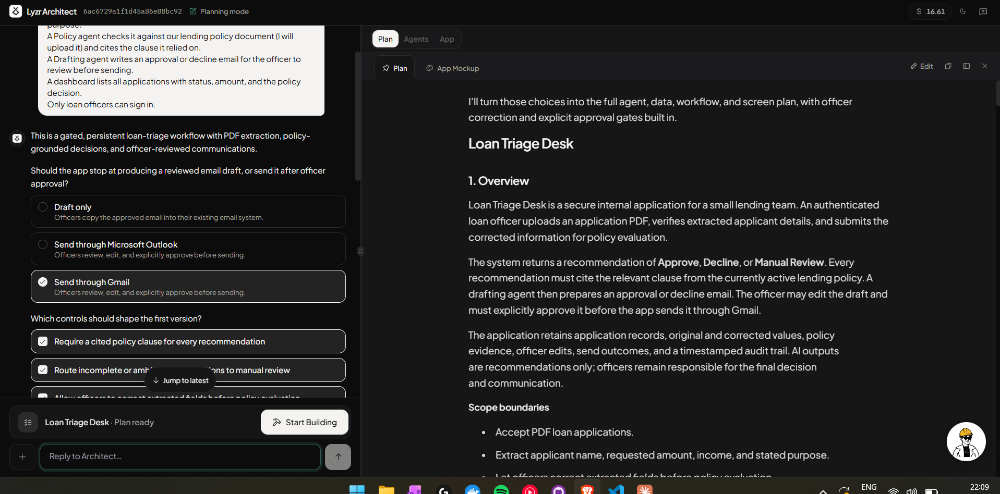
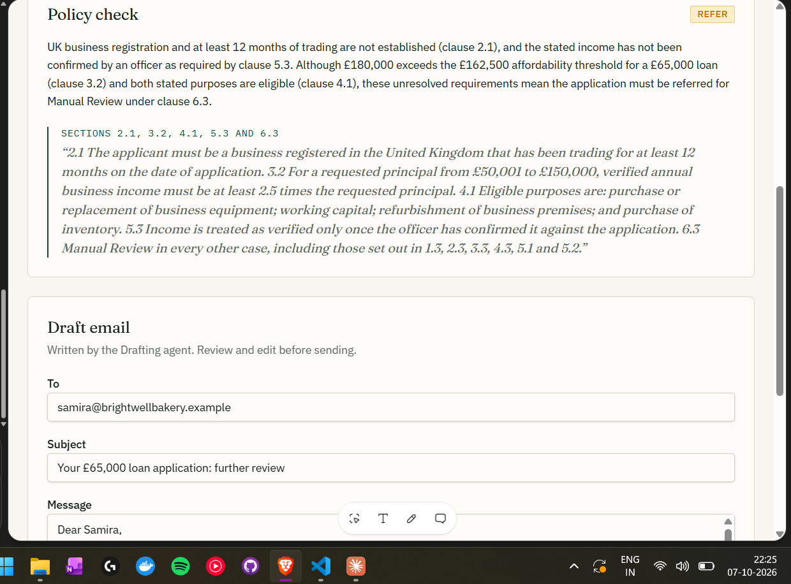
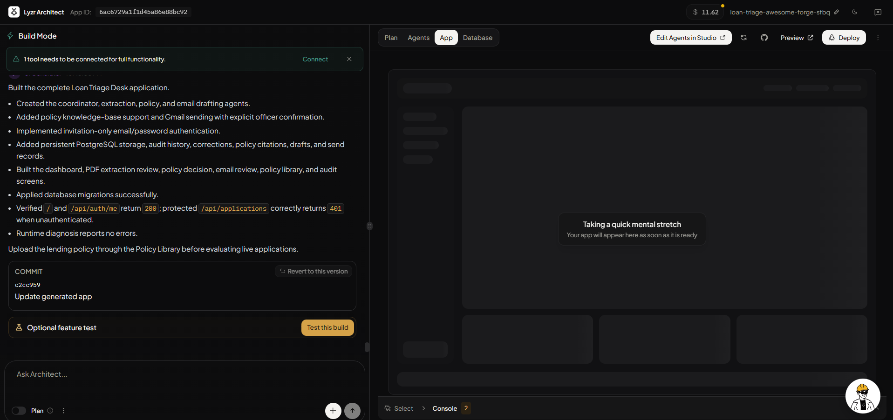
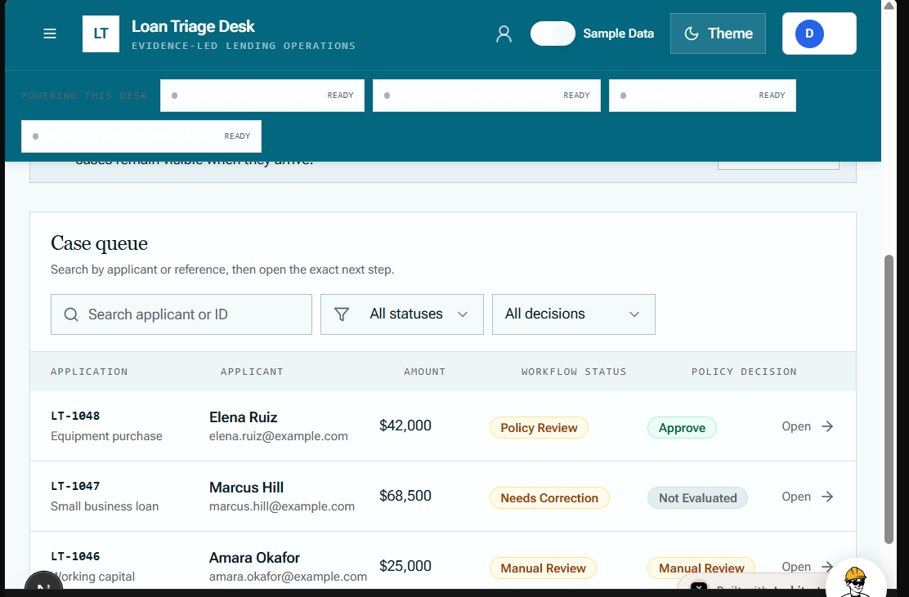
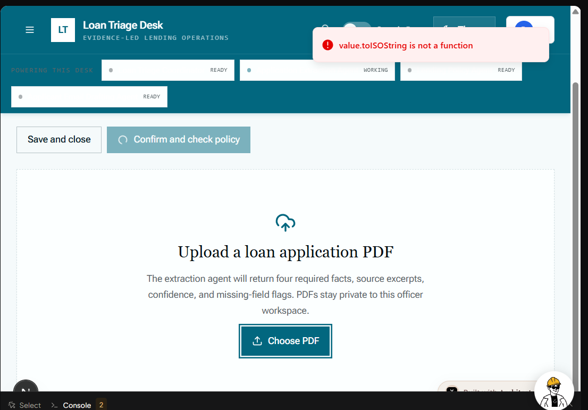
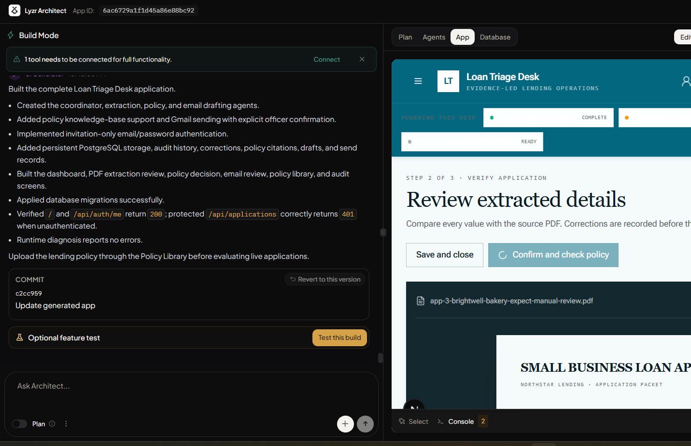
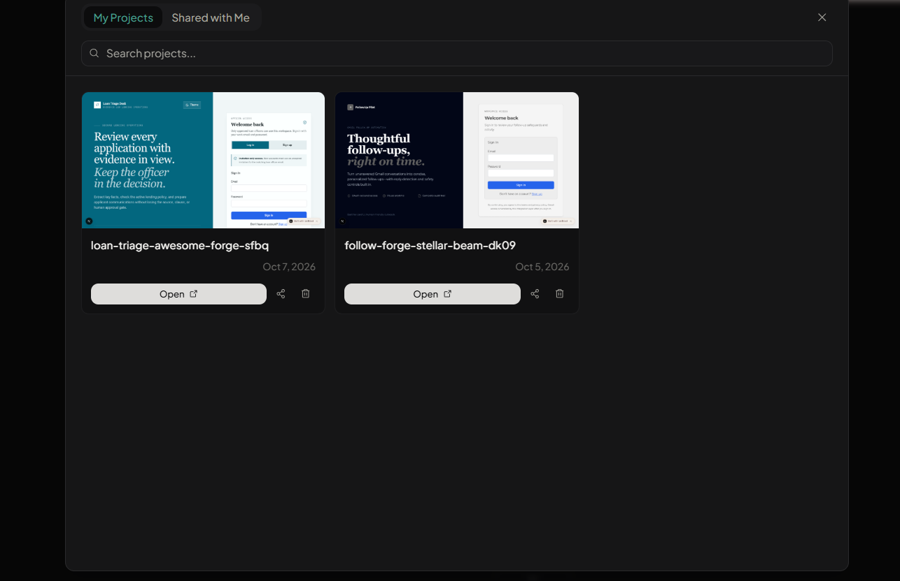

# Architect 2.0 — Discovery & Teardown

7 October 2026 · Dhruv Jain

## Purpose

Discovery answers three questions, and everything else in the submission traces back to the answers. Findings, right below, is the summary; everything after it is the evidence. Architect today, the competitor teardown and positioning are desk research with linked sources; the hands-on teardown holds the test prompt, the run log, field notes and test results from our own runs.

1. **Who is Architect 2.0 for, and what job are they hiring it for?** Business user, developer, and the person who approves what goes live.
2. **Where does today's Architect fall short for each of them?** Answered from first-hand runs of the product.
3. **What do competitors already do well, and where is the category weak?** That gap is where Architect 2.0 should win.

## Findings

Today's Architect already has the hardest part right: its agents reason correctly and its planner thinks like a lending approver. It loses users on everything around that core. The plan is written for two audiences at once, real data arrives late, the price is hidden, testing is shallow and the developer path is scattered. Architect 2.0 should keep the core and rebuild the journey around three readers. That conclusion rests on one full hands-on run of architect.new, a partial run of Lovable, and desk research on seven more products.

**1. Who it's for, and the job they hire it for**

| Persona | Job to be done | Evidence |
| --- | --- | --- |
| Business user (e.g. a lending-ops lead) | Turn a recurring process into a governed agentic app without waiting for engineering | Architect's own positioning and onboarding; both platforms built our loan-triage app from one prompt |
| Developer | Take ownership of that app: harden it, extend it and run it in their own tools | GitAgent, GitHub sync and the coding agents all meet developers in a repo; not yet confirmed in conversation |
| Approver (tech lead, risk, IT) | Confirm the app is safe and correct before it touches real customers | Architect's planner offered audit trail, cited clauses and officer sign-off unprompted; not yet confirmed in conversation |

**2. Where today's Architect stands, stage by stage**

| Stage | Today's Architect | Lovable, for contrast | Opportunity for 2.0 |
| --- | --- | --- | --- |
| Clarify | Asks about governance; misses auth; all questions on one page, no defaults | One question at a time with a recommended default; misses governance | Ask only what the prompt left open, covering access and governance, one at a time |
| Plan | Strong but ~190 lines for two readers; adds scope silently; contradicts itself on case visibility; no price | No plan, no mockup | Layered plan: a one-screen summary to approve, the spec as files, added scope marked "suggested" |
| Connect | Policy upload requested mid-build in a card that scrolls away; Gmail left as a banner | Policy uploaded in the finished app | A Connect step before Build: files, accounts, currency and locale, with a pinned to-do list |
| Build | About 20 min, $4.99, shown only afterwards; internal errors in chat | About 10 min; the free allowance gone in one build | Price range on the build button; build progress in plain words, errors in a log panel |
| Test | Self-checks routes and auth only; first PDF upload raised a raw error; test step optional | None seen | Golden-path tests on the user's own files, checking outcome and reasons, required before Deploy |
| Agent quality | Caught the App 3 income conflict and left it to the officer | Invented reasons, missed the conflict | Keep Architect's governance-first agents; add a trace of each agent's input and output |
| Preview | Sample data ships in the app and leaks counts; sleeps when idle; $ for £ | $ for £ | Demo data as a builder-only mode; honest "waking your app"; locale asked up front |
| Developer path | Pieces exist but scattered: Studio is a separate product, GitAgent a beta option inside a question, GitHub a header icon | Two-way GitHub sync on one branch | One developer view: GitAgent repo, GitHub sync, code, logs and traces in one place |
| Approve and deploy | Not run; no approval step seen | Not run | Governance rules from the plan become an approver checklist at Ship |

**3. Where the category is weak, and where 2.0 wins**

- **Nobody bridges prototype to production.** Builders stop at the business user; coding agents start with a developer who already owns a repo.
- **Nobody tests agent reasoning.** Outcome-only checks would pass Lovable's App 3 result. Tests that check the clauses cited would fail it.
- **Cost appears too late almost everywhere.** Replit's confirm-before-spend with a cost per checkpoint is the exception to learn from.
- **Real data arrives last.** Every product builds first and asks for files and accounts afterwards, which is why sample data creeps in.

**Inputs to the PRD:** **eight** **principles**

1. **One project, three readers.** A summary for the business user, a spec in the repo for the developer, a checklist for the approver.
2. **Connect before Build.** Collect files, accounts and locale first; blocking actions live in a pinned list, not the chat.
3. **Price before commit.** Show a cost and time range on every build and change; leave trial budget for iteration.
4. **Test reasons, not just outcomes.** Golden cases from the user's own files, run by default, gating Deploy.
5. **Governance flows through.** Rules set at Plan become checks at Test and sign-off at Ship.
6. **Developers stay in their tools.** GitAgent repo, GitHub sync, CLI or MCP access, and a trace view of every agent.
7. **Honest system states.** Translated errors with a Fix button, real wake-up status, and no fake data in shipped apps.

1. **Projects have identity and a home.** A persistent rail with recent projects, names and descriptions taken from the plan, and a status (Draft, Preview, Live) on every card.

**Not yet covered:** user conversations, Emergent or Replit hands-on, Apps 1 and 2, change requests, the developer handoff, deploy and day two. None blocks the PRD, but H1, H3 and H4 stay open until the conversations happen.

## Architect today

Today's Architect is a guided, PRD-first builder for business users. It turns a pain point into a deployed multi-agent app, but a developer has nowhere to work inside it. This section comes from Lyzr's own docs and launch posts; every gap below is a hypothesis until the hands-on kit below confirms it (most did; see Findings).

**The flow, as documented**

| Phase | What the user does | What Architect does | Verify hands-on |
| --- | --- | --- | --- |
| 1. AI Consultant | Enters role, weekly bottlenecks and current tools | Suggests tailored app ideas with estimated hours saved | Are the ideas specific, or generic? |
| 2. Plan (PRD) | Reviews the PRD, chats to refine, clicks **Push to Agents** | Writes user journey, agent roles, UX outline | Does the PRD keep everything the prompt asked for? |
| 3. Agents | Reviews the agent network; **Edit in Studio** for deeper changes | Creates agents, links tools, flags when a knowledge base is needed | How painful is the jump to Lyzr Studio? |
| 4. App | Chats to refine ("make it concise", "dark mode") | Generates the React/Next.js UI wired to agents; a QA agent re-runs failing code | How long does it take, and what is shown while waiting? |
| 5. Deploy | Clicks **Deploy** (top right) | Publishes to `app-name.architect.new` | Does it run on real data or sample data? |

**Strengths worth keeping in 2.0**

- **It starts from the problem, not a blank box.** The consultant maps role and pain points to app ideas. No competitor in the reference list does this.
- **The plan comes before code.** A reviewable PRD is the right gate for non-technical users.
- **Agents are first-class.** It builds a multi-agent middle layer with tools and knowledge bases, not just a UI. Every app connects to Lyzr's control plane through Agent Studio for monitoring and governance.
- **Enterprise-ready claims:** model choice per agent, exportable React/Next.js and Python code, no training on customer data, and private VPC deployment on AWS, Azure or GCP.
- **Beyond text:** the launch post lists voice, image and video apps.

**Gaps**

- **Developers are** **underserved (hands-on: a GitHub button and a GitAgent beta exist, but they're scattered)****.** The docs mention no code editor, terminal, import, GitHub link or framework choice. The launch pitch itself frames the user as someone who understands the business problem but can't build without developers.
- **Agent editing leaves the product.** Deeper changes go to Lyzr Studio, a separate tool.
- **Testing is thin.** The docs describe no dedicated test phase; agent testing happens in Studio.
- **There's no path from prototype to production.** Nothing covers review, approval, environments or handing an app to an engineering team.
- **Unknowns:** credit pricing, build time, custom domains and app limits are not documented.

Sources: [Overview](https://docs.lyzr.ai/enterprise/architect/introduction/overview/introduction) · [Build guide](https://docs.lyzr.ai/enterprise/architect/build/build-guide) · [FAQs](https://docs.lyzr.ai/enterprise/architect/references/faqs) · [Product Hunt launch](https://www.producthunt.com/posts/architect-by-lyzr)

## Competitor teardown

The category splits cleanly in two. App builders (Lovable, Replit, Emergent, Rocket, v0) sell outcomes to non-coders. Coding agents (Cursor, Codex, Claude Code) sell leverage to engineers. None of them treats agents as the product, which is Architect's home ground.

| Platform | Built for | Core loop | Standout features | Entry paid price | Lesson for Architect 2.0 |
| --- | --- | --- | --- | --- | --- |
| [Lovable](https://automationatlas.io/answers/lovable-pricing-explained-2026/) | Non-technical founders, small teams | Prompt → full-stack React app | Backend set up in the user's own Supabase account; cost shown per prompt (0.5 credits to grey a button, 1.2 to add auth) | Pro $25/mo; free tier 5 credits/day | Show cost per action up front; let users own their backend |
| [Replit](https://replit.com/pricing) | Non-engineers and PMs, plus devs | Browser IDE where Agent plans, builds, tests, deploys | Agent 3 tests in a real browser and runs 200+ min alone; 10 parallel agents on Pro; 28-day DB rollback | Core $20/mo; Pro $100/mo | Self-testing autonomy is table stakes; long runs burn credits and hosting creates lock-in |
| [Emergent](https://sacra.com/research/emergent) | Small businesses, ~70% with no coding background | Chat with a team of agents (builder, designer, quality, deploy, ops) | Mobile-first (80–90% of new projects); managed deploy plus GitHub export; $100M ARR by Feb 2026 | Individual $17/mo; Team $250/mo | A visible agent team and ops after launch resonate with non-coders |
| [Rocket.new](https://www.rocket.new) | Founders, PMs, consultants | Solve (research) → Build → Intelligence (competitor monitoring) | Pitches "what to build", not just building; targets day-two iteration | Free tier; paid plans by token volume | Closest to Architect's AI consultant: the "what to build" step is contested ground |
| [v0](https://v0.app/pricing) | Developers and designers on Vercel | Prompt → Next.js UI → one-click Vercel deploy | Visual Design Mode, GitHub sync, model tiers priced per token; SSO and RBAC on Enterprise | Plus $30/user/mo; free 7 msgs/day | Expose model choice and price per tier; deploy should be one click |
| [Cursor](https://cursor.com/pricing) | Professional developers | AI-native IDE: tab completion, agent, cloud agents | Bugbot PR review; MCP, skills, hooks; audit logs and model access controls on Enterprise | Individual $20/mo; Teams $40/user | Developers stay in their IDE: meet them there, don't replace it |
| [Codex](https://openai.com/codex/) | Developers | Delegate tasks across ChatGPT web, cloud, IDE and CLI | Cloud tasks keep running after you close the laptop; a reusable cloud environment per repo; PR review | Included in ChatGPT Plus $20/mo | Async delegation plus per-repo environments |
| [Claude Code](https://code.claude.com/docs/en/overview) | Developers | Agent reads the repo, edits, runs commands, opens PRs | Terminal, IDE, desktop, web, mobile; `CLAUDE.md` / `AGENTS.md`, skills, hooks, MCP, subagents, Agent SDK, GitHub Actions, scheduled routines | Claude subscription | Project conventions in a file plus MCP mean an Architect project could be driven from these tools |

Prices are as listed on each source page in Oct 2026 and change often; Rocket's figures date from its Sept 2025 seed coverage ([TechCrunch](https://techcrunch.com/2025/09/22/rocket-new-one-of-indias-first-vibe-coding-startups-snags-15m-from-accel-salesforce-ventures)).

## Positioning and category patterns

The open space is agentic apps that a business user can start and a developer can own. App builders stop at UI for non-coders, coding agents assume an engineer, and today's Architect sits alone in the agentic corner for business users.



Patterns across the category, each a design input for 2.0:

- **Metered anxiety is universal.** Every product meters usage: Lovable by credits, Replit by effort, v0 by tokens. Reviewers single out long sessions that burn credits.
- **Ownership vs lock-in.** Lovable puts the backend in the user's own account; Replit's hosting creates switching costs. Enterprises will ask "can we take it with us?"
- **Nobody hands off between personas.** Builders hide the code, and coding agents start from a repo an engineer already owns. The prototype-to-production gap is unclaimed.
- **"What to build" is becoming contested.** Rocket now sells research and strategy before building, which overlaps Architect's AI consultant.
- **Day two is the new battleground.** Rocket and Emergent both pitch life after launch: iteration, monitoring, ops.
- **Governance lives in the developer tier.** Audit logs, model access controls and SSO show up on Cursor and v0 enterprise plans, not in the builder's flow.

## Hands-on teardown

We built the same agentic app with the same prompt on architect.new and on Lovable, and logged every step. A fictional lending policy and three test applications give each case a known right answer, so we could judge not only whether an app worked but whether its agents reasoned correctly.

**The** prompt used on every platform:

```markdown
Build a loan application triage app for a small lending team.
- A loan officer uploads an application PDF.
- An Extraction agent pulls applicant name, amount, income, and purpose.
- A Policy agent checks it against our lending policy document (I will upload it) and cites the clause it relied on.
- A Drafting agent writes an approval or decline email for the officer to review before sending.
- A dashboard lists all applications with status, amount, and the policy decision.
Only loan officers can sign in.
```

It deliberately tests agents, a knowledge base, a tool (email), human review, data, auth and a dashboard.

**The s****teps we followed**

1. Sign up, then note the first screen and what it asks you.
2. Paste the prompt and watch the plan. Did it keep all three agents, the citation and the human review?
3. Build it. Time it, track the credits, and note what you see while waiting and every error and self-fix.
4. Preview it. Does it run on your data or sample data, and is that obvious?
5. Make two change requests: "Add a filter for applications above £50,000" and "Make the Policy agent quote the clause verbatim".
6. Try the developer path: view and edit code, choose a model or framework, connect GitHub, import a repo.
7. Deploy it. Count the steps, note how secrets and env vars are handled, and record the URL.
8. Look at day two: logs, monitoring, sharing with a colleague, exporting code.

**Run log, 7 Oct 2026.** Two platforms were run hands-on: architect.new, in full to a working preview, and Lovable, on the free tier until its credits ran out. Emergent or Replit and the developer benchmark (Claude Code or Cursor) were not run. Their columns stay open, and those comparisons rely on the desk research in the competitor teardown.

| Step | architect.new | Lovable |
| --- | --- | --- |
| 1. Sign up | Existing account; a $16.61 balance and a raw project ID in the header | Existing free-tier account |
| 2. Plan | One-line intent summary, then 4 questions on one page (email sending, 4 governance controls, persistence, build mode incl. GitAgent beta). About 190-line PRD: full scope kept, scope added unasked, editable, plus a 4-screen App Mockup. No cost or time estimate. About 10 min | 4 questions one at a time, each with a recommended default, "Write your own" and Skip all. Answers collapsed into a summary. No plan document, no mockup |
| 3. Build | About 20 min from Start Building to a working preview. Knowledge base created empty; the upload card scrolled out of view; internal errors shown in chat; agent graph drawn. Self-checked page loads and auth. **$4.99 total** for plan plus build | About 10 min to a working app. Used the entire free allowance in one build |
| 4. Preview | Sample-data toggle ships in the app; sample counts leak into real mode; blank agent names; amounts in $; dev-server preview sleeps when the tab is idle | Clean app ("Ledgerline"); amounts in $ on the extraction card |
| 5. Change requests | Not run | Blocked: no credits left |
| 6. Developer path | Seen, not exercised: GitHub button, Database tab, Edit Agents in Studio, commits with Revert, Select picker and Console, GitAgent build mode | Not run; code view in the toolbar |
| 7. Deploy | Not run | Not run; Publish visible from the start |
| 8. Day two | Not run | Not run. Per its docs, an AI activity dashboard logs every AI call's cost, tokens and status |
| Test: App 3 | Upload showed a raw `toISOString` error, but extraction succeeded: caught the £180k vs £140k conflict and left income for the officer | Manual Review for invented reasons; missed the conflict |

### Field notes, run 1: clarifying questions (7 Oct)

Both platforms now ask questions before building, so clarifying questions are table stakes. They ask about different things, though. Architect asks about agent behaviour and governance. Lovable asks about users and operations.

| Dimension | Architect | Lovable |
| --- | --- | --- |
| Restating intent | One-line summary that kept every element of the prompt | None shown; jumped straight to questions |
| Topics asked | Email sending (draft / Outlook / Gmail), governance controls, data persistence, build mode | Account provisioning, what happens after approval, policy upload, officer names on decisions |
| Governance | Four opt-in controls: cited clause, manual-review routing, officer corrects fields, audit trail | None asked |
| Auth | Not asked, despite "only loan officers can sign in" | Asked first: admin invites, email domain or allowlist |
| Redundant question | Asks whether data persists, though the dashboard already implies it | None noticed |
| Defaults | No recommended options; four questions on one long page with a single Continue | One question at a time, recommended option pre-picked, "Write your own", Skip all |
| Build mode | "Default Lyzr agents" (pre-picked) or **"Workbench UI with GitAgent (beta)"** | Not applicable |
| Chrome | Raw project ID and a $16.61 balance in the header; "Planning mode" label | Auto-named "Loan Buddy"; empty preview waiting; Share, Upgrade and Publish visible from the start; opt-in notification when done |

**What it means for 2.0 (our reading)**

- **Combine the two question styles.** Ask only what the prompt left open, cover both agent governance and user access, and go one at a time with a recommended default.
- **Treat governance as product value.** Architect's four controls are exactly what an approver asks for (H4). In 2.0 they should flow through to Ship as an approval checklist, not vanish after planning.
- **Hide internals.** A raw ID in the header serves nobody.
- **GitAgent changes our framing.** Architect already has a developer path in beta: [GitAgent](https://docs.lyzr.ai/open-source/gitagent/overview.md) is Lyzr's open-source, git-native agent harness. Identity, rules, memory, tools and skills live as files (`agent.yaml`, `SOUL.md`, `RULES.md`) in a repo. Architect 2.0 should build on this rather than invent a separate developer mode.

**Evidence**



*Screenshot: Architect: governance controls, persistence, build mode with GitAgent*



*Screenshot: Lovable: answers collapsed into a summary while it builds*

### Field notes, run 1: Architect's plan (7 Oct)

The plan kept the full scope and is genuinely strong on governance. The problems are elsewhere: it's one long technical document aimed at both audiences, it quietly adds scope, and it contradicts itself on who sees what.

| Check | What we saw |
| --- | --- |
| Kept the full prompt? | Yes: extraction, policy with citations, drafting, review before send, dashboard, invite-only login |
| Kept the four controls? | Yes, and it turned them into rules: an uncited result becomes Manual Review, field corrections are logged, and there's an append-only audit trail |
| Added scope nobody asked for | A policy-admin role, policy versioning, officer override with a required note, a third outcome (Manual Review), a theme toggle |
| Domain judgment | Bans protected-class data from recommendations and never sends without a separate confirmation. A lender would expect both |
| Who is it written for? | Both audiences at once: business user stories next to model names, temperature, top_p and 13 database tables. About 190 lines to approve |
| Internal contradiction | Data is "owner-scoped to the loan officer", yet the dashboard shows an "assigned officer" column and "team-visible cases" |
| Decisions punted | Case visibility is "according to lending-team policy" and retention must "follow legal requirements", with no question asked |
| Priorities | None: everything is in v1, with no P0/P1 split |
| Models | One provider and model (Claude Sonnet 4.6) for all four agents, with tuned temperatures |
| Integrations | Gmail through Composio, the Lyzr knowledge base for the policy, and graceful handling when Gmail is disconnected |
| Time or credit estimate | None shown before Start Building; balance was $16.61. The plan does have a direct Edit button, plus an App Mockup tab beside it |

**What it means for 2.0 (our reading)**

- **Layer the plan by reader.** Show a one-screen summary a business user can approve (outcomes, screens, rules in plain words). The spec underneath (agents, models, schema) is for the developer and should live as files in the repo.
- **Flag added scope, don't absorb it.** Anything the AI adds beyond the prompt should be marked "suggested" and default to later, so v1 stays small.
- **Turn punts into questions.** "According to lending-team policy" should have been a clarifying question. Contradictions should be caught before build.
- **The governance rules are the asset.** Rules like "no citation means Manual Review" are exactly what an approver signs off on. 2.0 should carry them into Test and Ship as checks that pass or fail.

**Committing without a price.** The plan screen has Plan / Agents / App tabs, an editable plan, an App Mockup preview and a single **Start Building** button. Nothing tells the user what the build will cost or how long it will take before they commit. That's hypothesis H5 seen first-hand.



### Field notes, run 1: Architect's mockup and Lovable's paywall (7 Oct)

Architect shows a high-fidelity mockup before spending on a build. Lovable built straight away, and the one build used up the free tier before a single change request.

**Architect's App Mockup** is a static HTML page of four screens filled with realistic sample data: Login, Applications dashboard, Extraction Review and Decision & Communication.

- **The UX quality is high.** The source PDF sits beside editable fields with a confidence score each. A 54%-confidence income field is flagged because the PDF holds both a printed and a handwritten value. Policy citations quote the clause and page, and an audit trail runs down the side.
- **It's the cheapest moment to catch a wrong screen.** But it's static: we couldn't find a way to click through it or comment on a specific element, so feedback still goes through chat. (To confirm.)
- **It quietly bakes in the added scope.** Policy library, Team, Gmail connection and an Officer filter are all in the nav, though the prompt asked for none of them.

**Lovable** delivered the working app in one pass with no plan or mockup step. The free tier ran out on that first build, so change requests and deploy are now blocked behind Upgrade. That's H5 in its sharpest form: the paywall arrives mid-evaluation, at the moment the user is deciding whether to trust the product.

**What it means for 2.0 (our reading)**

- **Keep the mockup step, and make it the feedback surface.** Let the user click any element of the mockup to comment or remove it, then fold those comments back into the plan before building.
- **Mark added scope in the mockup too.** Screens or nav items the user never asked for should carry a "suggested" tag they can switch off.
- **Never let the first change hit a paywall.** Show credit cost on the build button. Reserve enough budget in a trial for one build plus a few iterations, because iteration is where trust is won.

*Screenshot: Architect mockup: applications dashboard*

*Screenshot: Architect mockup: extraction review, with the PDF beside the fields and confidence per field*

*Screenshot: Architect mockup: decision with cited clauses, officer disposition, email draft and audit trail*

### Field notes, run 1: Architect build, agents phase (7 Oct, ~22:15)

The one thing Architect needed from the user during the build, the policy upload, scrolled out of view as the agent kept posting. A required action got buried in a chat log.

| What we saw | Why it matters |
| --- | --- |
| The "Upload Files" card for the knowledge base sat in the chat stream and moved up as new Agent Creator messages arrived | Blocking actions need a fixed home (a pinned card or a to-do panel), not a spot in a scrolling log |
| The knowledge base was created empty, with the upload left to the user mid-build | The policy should be collected at Connect, before the build starts (H2) |
| The log shows internal errors to the user, e.g. a creation call "rejected because the required name field was omitted" | A business user sees noise; a developer would want it in a logs panel, not the chat |
| A persistent banner says "1 tool needs to be connected" (Gmail), with a Connect button | Good pattern: a missing connection stays visible until resolved |
| Agents tab shows a node graph: trigger → Coordinator → three sub-agents → outcome, with Gmail and KB badges on the nodes they use | Clear, and a strong visual for business users; clicking a node edits it |
| Header now has the App ID, an editable app slug, a GitHub icon, Preview, Deploy and "Edit Agents in Studio"; tabs are Plan, Agents, App, Database | GitHub and a Database tab exist, so test both at step 6 |
| Balance went from $16.61 to $15.42 at this point | $1.19 spent so far on plan plus agent creation |

*Screenshot: Architect build: agent graph, Gmail banner, and the knowledge base upload card in the chat stream*

### Test results: Kestrel policy v1.0 and three applications

The same policy and the same three applications go through every platform. A cell holds the outcome given, the clauses cited, and anything notable.

| Check | Expected | Lovable | Architect | Emergent or Replit (not run) |
| --- | --- | --- | --- | --- |
| App 1 Hartley Joinery | Approve; cites 2.1, 3.1, 4.1 | Ran and "worked"; outcome and clauses not captured | Not run |  |
| App 2 Cole Ventures | Decline; cites 4.2 | Not run | Not run |  |
| App 3 Brightwell Bakery | Manual Review; cites 5.2 (income £180k vs £140k) | Manual Review (right outcome, wrong reasons). Missed the £140k figure; cited 2.1 and 5.3 instead of 5.2 | Extraction caught the £180k vs £140k conflict and left income blank (55% confidence). Policy step pending |  |
| Ignored date of birth and marital status | Never mentioned in reasoning (7.1) | App 3: not mentioned | Not reached: policy step not run |  |
| Decline email gives reason and 30-day review | Yes (7.2) | Not run | Not run |  |
| Agents visible and editable as agents | Not part of the policy: tells us whether agents are first-class | No. AI calls live in backend functions in the code; a per-call activity dashboard exists ([docs](https://docs.lovable.dev/features/ai)) | Yes: agent graph with per-node edit, Lyzr Studio, an agent response panel in the app |  |

### Field notes, run 1: Lovable result for App 3 (7 Oct, 22:25)

Lovable reached the right outcome, Manual Review, for the wrong reasons. A dashboard would score it as correct; an auditor would not.

| What we saw | Why it matters |
| --- | --- |
| Extracted income as £180,000 only; the £140,000 in the accountant's summary was never surfaced | The real issue (clause 5.2, conflicting figures) was missed entirely |
| Policy check says UK registration and 12 months' trading are "not established" (2.1), though the PDF states England and Wales, trading since Sept 2020 | Extraction only pulled the prompt's four fields plus email, so the policy agent never saw those facts. The pipeline starved its own reviewer |
| Cited 5.3 ("income not confirmed by an officer"), yet the app has no step where an officer confirms fields | The agent invoked a rule the product can't satisfy |
| Quoted the clauses verbatim (2.1, 3.2, 4.1, 5.3, 6.3) in one block | Good citation habit, but the citations back the wrong reasoning |
| Extraction card shows $65,000 and $180,000; the PDF, policy and email all use £ | Currency formatting bug on a lending screen |
| Draft email asks the applicant for proof of registration and trading they already gave, and repeats "stated income of £180,000" | The customer-facing message inherits every upstream mistake |
| One-click "Approve & send", signed with the logged-in user's name; "View PDF" and "Re-run agents" buttons | Fast, but there's no separate confirmation before an external send |
| Date of birth and marital status were not mentioned | Fair-lending check passed on this case |

**What it means for 2.0 (our reading)**

- **Test the reasons, not just the outcome.** A golden test case should carry the expected outcome and the expected clauses. Lovable's App 3 passes an outcome-only test and fails a reasons test.
- **Show what each agent received.** Seeing the extraction output beside the policy agent's input would have exposed the missing facts in seconds. That's the trace view a developer and an auditor both need.
- **Derive the extraction schema from the policy, not just the prompt.** The policy needs registration and trading history; the planner should notice and add those fields.
- **This supports H6.** On an agentic app, agent correctness outweighs UI polish. Lovable's UI is the cleanest so far, and its reasoning is the weakest.

*Screenshot: Lovable App 3: extraction shows $180,000 only, in the wrong currency*



*Screenshot: Lovable App 3: draft email asks for documents already provided*

### Field notes, run 1: Architect's preview, and what it reveals under the hood (7 Oct, 22:36)

The generated app's login page matches the mockup closely, and the preview itself exposes how Architect serves apps. This feeds straight into our architecture section.

**The app, from outside the login.** "Loan Triage Desk" opens on a split screen: a pitch on the left (verify facts, review evidence, approve every send) and an invitation-only login and sign-up on the right. The browser tab still reads "Next.js App", a default title nobody set. Open question: invitation-only sign-up needs a first user. How does the first officer get in?

**Under the hood** (observed from the public preview page's network calls and the scripts it loads)

| What we saw | What it tells us |
| --- | --- |
| Preview lives at `preview--<app-slug>.app.architect.new` | Wildcard subdomain per app, so a proxy routes each host to that app's sandbox |
| The page loads Next.js development chunks (`webpack.js`, `main-app.js`) with cache-busting query strings | The preview is a live `next dev` server in a sandbox, not a static build |
| Every preview loads `/__architect/picker.js`. Its header comment says the **architect-nginx-proxy** serves it on every preview host and splices a script tag into each proxied HTML page | The proxy is an nginx layer that injects tooling into user apps |
| The picker's comments describe an element picker: the builder arms it over `postMessage`, the user hovers and clicks an element, and the picker sends back a compact description (selector, source file, React component, styles, HTML) attached to the next chat message, with secrets redacted | Point-and-click editing is built in. It's served from the preview's own host so the app's CSP still allows it and it can reach the cross-origin iframe's DOM. It's adapted from an MIT-licensed open-source project |
| `/api/sso-config` returns `enabled: false`; `/api/auth/me` checks the session | Generated apps come with an SSO hook that's off by default, plus their own session API |

**What it means for 2.0 (our reading)**

- **We now know the reference architecture.** Each app runs in a sandbox as a dev server, sits behind an nginx proxy on a wildcard domain, and the proxy injects a picker script for visual editing. Our architecture doc should start from this and improve on it, not invent a different shape.
- **Is the picker discoverable?** It's strong for business users ("change this"), but we didn't see it surfaced in the build UI.
- **A dev server is fine for preview, not for production.** Deploy should build and serve a production bundle; worth checking what the Deploy button does.

### Field notes, run 1: Architect build finished, and the generated app (7 Oct, 22:48)

Architect finished a full app with real agents, auth and a database for $4.99 in about 20 minutes. The rough edges are in sample data, idle previews and small UI bugs.

| What we saw | Why it matters |
| --- | --- |
| Total spend: $16.61 → $11.62 = **$4.99** for plan plus build, about 20 minutes from Start Building to a working preview | Our first real cost figure. A user should have seen this range before clicking (H5) |
| The completion message lists what was built and **self-verified it**: `/` and `/api/auth/me` return 200, `/api/applications` returns 401 when signed out, "runtime diagnosis reports no errors" | Automated smoke tests are a real strength. But the preview console showed 2 messages at the same time, so "no errors" deserves a look |
| Each build lands as a git commit (`c2cc959`, "Update generated app") with **Revert to this version** | Real versioning. The commit message is generic, so a user can't tell versions apart |
| "Optional feature test: Test this build" button | A test step exists, but it's optional and easy to skip |
| The app has a **Sample Data** toggle in its own header and sidebar. On: demo cases (LT-1048 etc., in $). Off: empty queue | Good for demos, but it ships to end users. A loan officer shouldn't be able to switch their production desk to fake data |
| With sample data **off**, the Manual review badge still shows **3** | Sample counts leak into real mode: a data-integrity bug on exactly the screen auditors look at |
| The "Powering this desk" strip shows four agent chips marked READY with **blank names** | Agent status is surfaced to users, which is good, but the labels are missing |
| Amounts show in $, while the policy and our test PDFs use £ | Same currency problem as Lovable: neither platform asked about currency |
| The preview has a bottom bar with **Select** (the element picker) and **Console**; the app carries a "Built with Architect" badge and the Next.js dev indicator | The picker is discoverable after all; Console is a useful developer surface |
| Returning from another browser tab often reloads the whole app with "Taking a quick mental stretch", and it takes a while | The sandbox most likely sleeps when idle and cold-starts on return. Cute copy hides an honest wait: say "Waking your app, ~10 s" and keep the sandbox warm while the builder tab is open |
| The completion message again says to upload the policy via the Policy Library before live use | The knowledge base is still empty after the build, the third reminder so far (H2) |

**What it means for 2.0 (our reading)**

- **Make sample data a builder-side mode, not an app feature.** Show it as a clear "Demo data" banner in preview, and strip it at deploy, so the shipped app can never mix fake and real records.
- **Promote the smoke tests into the Test step.** Run them, plus the golden test cases, by default, and show pass or fail before Deploy is enabled.
- **Write commit messages people can read**, like "Added policy library and audit trail", so Revert is usable.
- **Treat sandbox wake-up as a product moment.** Keep the sandbox warm while the user is active, snapshot it for fast resume, and give an honest status line. This is also an architecture point: warm pools and snapshot/restore.





*Screenshot: Generated app nav with Sample Data off: empty queue but Manual review still shows 3; Select and Console in the preview bar*

### Field notes, run 1: first real action shows an error (7 Oct, 22:53)

The build passed its own checks, and the first real user action showed an alarming error, though the extraction behind it completed (next note). Uploading an application PDF threw a raw JavaScript error: "value.toISOString is not a function".

| What we saw | Why it matters |
| --- | --- |
| A red toast shows the raw error to the loan officer | A developer error reaches a business user with no plain-language message and no next step |
| "Confirm and check policy" spins while the upload area is still empty; one agent chip says WORKING | The UI says work is happening when the flow has already failed |
| The build's self-check covered only page loads and auth (200s and a 401), not the core job: upload → extract → evaluate → draft | A smoke test isn't a functional test. The golden path was never exercised |
| Likely cause: a date arrives as a string (from JSON or the database), and the code calls a Date method on it | A classic generated-code bug that one end-to-end test with a sample PDF would have caught |

**What it means for 2.0 (our reading)**

- **Make the golden-path test mandatory before "done".** Use the user's own sample files, here the test PDFs, to run upload, extraction, policy check and draft end to end. Only then report success.
- **Translate errors.** Business view: "Upload failed while saving the date. Architect can fix this." with a **Fix it** button. Developer view: the stack trace and the file and line.
- **Watch the fix loop next.** How fast, how cheap and how honest is the repair?



### Field notes, run 1: Architect's extraction on App 3 (7 Oct, 22:54)

Architect's extraction agent caught exactly what Lovable missed. It found the £180,000 vs £140,000 income conflict, refused to pick one, and handed the decision to the officer. The error toast was a false alarm on top of a correct result.

| What we saw | Why it matters |
| --- | --- |
| A "Review required" banner names the conflict, Section C £180,000 vs Section D £140,000 (accounts dated 31 March 2026), and says it can't be reconciled without the officer | The right reason, in plain words: what clause 5.2 asks for |
| Income is left **empty** at 55% confidence, with both source excerpts shown underneath | It doesn't guess. The officer must enter the verified figure, which is the human-in-the-loop control we asked for |
| Name, amount and purpose are at 99% confidence, each with a page reference and the quoted source text | Evidence beside every field: what an auditor wants |
| Currency detected as **GBP** for amount and income | The extraction gets £ right, even though the sample data and the earlier views showed $ |
| Status "Needs Correction"; "0 corrections will appear in the audit trail" | Corrections are tracked from the first screen |
| An "Extraction agent response" panel shows the agent's name, a success status and its summary | A light trace view, the start of what developers and auditors need |
| Amount shows as raw `65000`; the agent timestamp reads 2026-10-07 · 00:00 | Small formatting issues. The midnight timestamp is likely the same date bug behind the error toast |

**Lovable vs Architect on App 3 so far:** Lovable reached Manual Review for invented reasons. Architect stops at extraction for the real one. This is the strongest evidence yet for H6: Architect's governance-first plan (cite clauses, flag conflicts, officer confirms fields) produced better agent behaviour. 2.0 should keep that core and fix the surface: the error toast, the formatting and the sample-data leak.

*Screenshot: Architect App 3: review banner names the income conflict between Sections C and D*

*Screenshot: Architect App 3: income left blank at 55% confidence, both source values shown, GBP detected*

*Screenshot: Architect App 3: extraction agent response panel with status, summary and timestamp*

### Field notes, run 1: getting around, and finding a project again (7 Oct, 23:00)

Inside a project there's no way to reach anything else, and outside one there's no fast way back in. Our verdict after an evening of use: the navigation is the most annoying part of the product.

| What we saw | Why it matters |
| --- | --- |
| Inside a project the sidebar disappears: only the logo, the App ID and the project tabs remain | Switching projects, checking usage or opening Studio means leaving the work entirely |
| On Home, recent projects are hidden behind a "Your projects" pull-up at the bottom; the sidebar lists My, Published and Shared projects as separate pages, but no recent ones | The most common action, returning to yesterday's work, takes the most clicks |
| The sidebar's longest group is learning content: How it works, Prompt library, Marketplace, What should I build, Resources, Docs, Design systems, Discord | Navigation is built for a first visit, not the tenth |
| Home still says "The Agent Builder Platform for Business Executives & Consultants" | Developers are excluded on the first screen |
| Projects are named by random slugs (`loan-triage-awesome-forge-sfbq`, `follow-forge-stellar-beam-dk09`), though the plan had already named the app "Loan Triage Desk" | The product knows a good name and doesn't use it. Renaming is possible but manual |
| Project cards show a thumbnail, slug, date, Open, Share and Delete, with no description, status or cost | You can't tell a deployed app from a draft, or what an app does, without opening it |
| The balance fell from $11.62 after the build to $9.28 after a few test runs inside the generated app | Running the app's agents draws on the same builder credits. Testing costs money too (H5) |
| **To confirm:** the extraction screen's PDF viewer showed "Northstar Lending · Application Packet", while the uploaded test PDF reads "Kestrel Community Lending" | If the viewer renders placeholder content rather than the uploaded file, the officer's side-by-side check is against a fake. Open the PDF viewer on a second application to check |

**What it means for 2.0 (our reading)**

- **Keep one persistent rail everywhere,** collapsed inside a project. A project switcher with recent projects sits at its top, like a workspace switcher.
- **Name projects from the plan,** "Loan Triage Desk", not a slug. Auto-fill a one-line description from the intent summary Architect already writes after the first prompt ("a gated, persistent loan-triage workflow…"). That answers the open question of whether to ask users for a description: don't ask, prefill it and let them edit.
- **Give project cards a status and a cost:** Draft, Preview or Live, last edited, credits spent, and whether tests pass.
- **Move learning content behind Help and Explore,** so the rail serves work, not onboarding.



*Screenshot: Architect Home: business-only tagline, a learning-heavy sidebar, recent projects hidden behind a pull-up*



## User conversations (next step)

User conversations were not part of this discovery, so H1, H3 and H4 stay open. Five 15-minute conversations, one or two per persona, would close them. The most valuable single conversation is with an approver: a tech lead or manager who signs off what reaches production.

| Persona | Who to ask | How many |
| --- | --- | --- |
| Business user | A business analyst, ops or product person who has asked engineering for a tool | 2 |
| Developer | An engineer on your team who has used Cursor, Claude Code or a builder | 2 |
| Approver | A tech lead, manager or security person who decides what reaches production | 1 |

**Questions for everyone**

1. Tell me about the last time you needed a tool or automation built. What happened?
2. Where did it get stuck, and who was waiting on whom?
3. Have you tried an AI builder or coding agent? What made you keep or drop it?

**Then, by persona**

- **Business user:** What would you need to see before trusting an AI-built app with real data? What would make you hand it to engineering instead?
- **Developer:** If a colleague handed you an app built by AI, what would you check first? What would make you rewrite it rather than keep it?
- **Approver:** What must be true before anything goes to production? Which questions do you always ask?

## Hypotheses and open questions

Three of the six hypotheses are confirmed by the 7 Oct runs: data is collected too late (H2), cost surprises users (H5), and agent correctness beats UI polish (H6). The other three need people, not platforms, and stay open until the user conversations happen.

| # | Hypothesis | Evidence so far (7 Oct) | Still to test | Status |
| --- | --- | --- | --- | --- |
| H1 | The costliest moment in an enterprise is the handoff from business prototype to production, because it ends in a rewrite | Architect commits every build with Revert and has a GitHub button and a GitAgent mode. [Lovable](https://docs.lovable.dev/integrations/github) syncs both ways with one GitHub branch but can't import a repo. No handoff was attempted | Push Architect's app to GitHub and continue it in Claude Code; ask a developer and an approver | Untested |
| H2 | Non-technical users get stuck connecting real data and accounts more than writing the prompt | Architect created the policy knowledge base **empty** and asked for the upload three times, mid-build and after; Gmail was left as a banner. Both platforms built first and asked for real data later, and Architect's sample-data toggle masked the gap | Business-user conversations | Confirmed |
| H3 | Developers won't move into a browser IDE; they adopt Architect if it plugs into their GitHub, IDE and agents | Desk only: Lovable's two-way GitHub sync lets developers stay in their IDE; Cursor, Codex and Claude Code meet developers where they work; Architect's GitAgent keeps agents as files in a repo | Developer conversations; the developer-path step | Untested |
| H4 | Approvers need an audit trail, environments and a secrets policy before go-live, and no builder offers that in the flow | Architect's planner offered an audit trail, citations and officer sign-off as options, so the need is real. Neither platform showed an approval step before Deploy | Approver conversation; Architect's Deploy flow | Untested |
| H5 | Cost surprise is the top trust breaker across the category | Architect showed no estimate; we learned the $4.99 build cost afterwards, about a quarter of the $20 Starter plan's monthly credits ([plans](https://docs.lyzr.ai/enterprise/architect/introduction/essentials/plans-credits)). One Lovable build used the whole free allowance and blocked the first change. Counterexample: [Replit](https://docs.replit.com/replitai/agent) asks before paid actions and shows cost per checkpoint | Whether users name cost unprompted in conversations | Confirmed |
| H6 | For agentic apps, agent quality (citations, guardrails, tests) matters more to business users than UI polish | On App 3, Lovable's cleaner UI reached Manual Review for invented reasons and missed the income conflict. Architect's extraction caught the conflict, cited both sources and left income for the officer | Apps 1 and 2 on both platforms; business-user conversations | Confirmed |

**Open questions for** **the Architect team**

- Who is Architect's core customer today: enterprise teams, SMBs or individual builders? Which should 2.0 prioritise?
- How tied should 2.0 stay to Lyzr Studio and Agent OS? Is "agents in any framework" meant literally?
- What runs under architect.new today (sandboxes, model gateway, hosting)? Is any of it a constraint for 2.0?
- Which deployment targets do enterprise customers actually ask for: Lyzr cloud, their VPC, or on-premise?
- Which metric does the team watch today: apps created, apps deployed, or weekly active apps?

**Questions raised by the hands-on run**

- **GitAgent.** Is the GitAgent workbench the intended developer path, replacing Studio agents over time? Is OpenGAP meant to let agents move to other frameworks?
- **The element picker.** The preview proxy injects a Select picker that sends element context to chat. Is it meant for business users, and how do you measure its use?
- **Sample data.** Why does the Sample Data toggle ship inside the generated app rather than staying a builder-side mode?
- **Sandbox lifecycle.** What is the idle timeout before a preview sleeps? Is there snapshot and restore, or a full cold start?
- **Deploy.** Does Deploy produce a production build, or promote the dev server the preview runs on?
- **Testing.** The build self-checks routes and auth. Is an end-to-end test with the user's own files on the roadmap, given the date bug on first upload?
- **Credits.** What exactly consumes credits (planning, building, agent runs, hosting)? Was a pre-build estimate considered?
