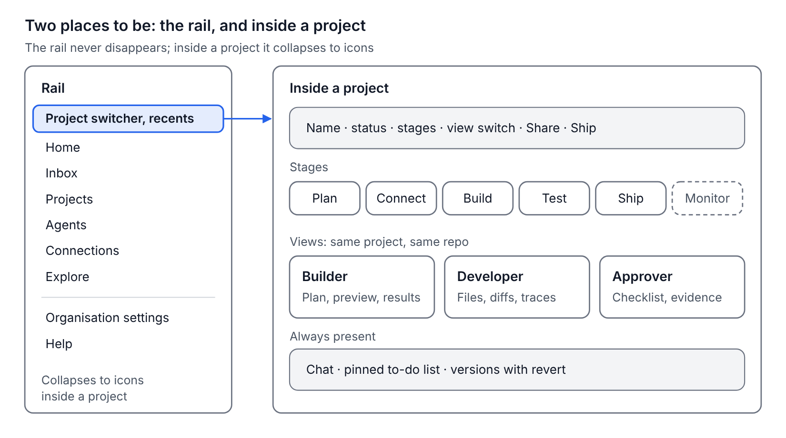
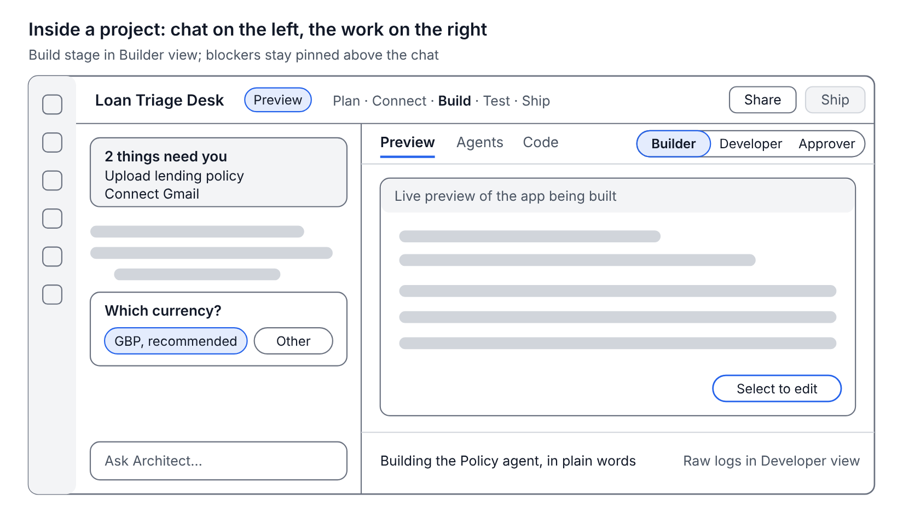
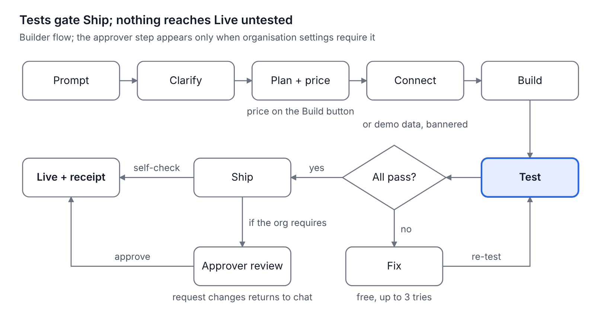

# Architect 2.0 — Flows and Screen Map

11 October 2026 · Dhruv Jain

This is the blueprint for the prototype: where everything lives, how each role moves from prompt to production, and every screen we build. It follows the [PRD](PRD.md): one project, five stages, three roles.

## Information architecture

There are only two places to be: the rail, which is on every screen, and the inside of a project. Recent projects sit at the top of the rail, because returning to yesterday's work is the most common thing users do, and today it takes the most clicks.

What changed from today's Architect, and why:

- **Recents in the rail, never hidden.** Today the sidebar disappears inside a project and recents hide behind a pull-up on Home.
- **Inbox is new.** One place for "what needs me" across projects: reviews to approve, invites, alerts, failing tests. It's how approvers and developers arrive.
- **Learning content moves into Explore.** Today, at least eight sidebar entries are learning content (How it works, Prompt library, Marketplace, What should I build, Resources, Docs, Design systems, Discord); they now share one entry, with the AI consultant, templates, prompt library and marketplace inside it.
- **Organisation settings hold roles and policy.** Members, roles, the approval rule, allowed models, usage and billing.
- **Monitor appears after the first deploy.** Before that, there is nothing to monitor.

## Workspace layout

Every project uses one layout: the conversation on the left, the work on the right, and the stage and view controls along the top. Switching view changes what the right side shows, never which project you're in.

Five decisions behind this layout, each from what we saw in discovery:

- **Blockers are pinned, not posted.** Anything the build needs from the user lives in the to-do card above the chat until it's done. Today, the policy upload card scrolled out of view.
- **Questions are cards with a recommended answer.** One at a time, never a long form.
- **The stepper always shows where you are.** Plan, Connect, Build, Test, Ship; a stage can't be skipped, but earlier ones can be reopened.
- **Ship is always visible but only enabled when tests pass.** Hovering it explains what's missing.
- **Plain words for builders, raw logs for developers.** The same event, shown twice.

How the three views change the right side:

|  | Builder view | Developer view | Approver view |
| --- | --- | --- | --- |
| Canvas | Preview, agent graph, test results in plain words | Files and editor, terminal, diff, logs, agent traces, environment and secrets | What changed, checklist with evidence, data and access |
| Chat | Full chat with question cards | Architect's own coding agent: edits files, runs tests, explains code | Comments that become change requests |
| Main action | Ship: self-check, or request review | Sync to GitHub, open a pull request | Approve and deploy, or request changes |
| Opens by default for | Builders and anyone without a role | Developers | Approvers arriving from the Inbox |

## Flow A: builder, from prompt to live

The builder's path runs through all five stages, and Test is the gate: nothing reaches Live until every golden case passes on both outcome and reasons.

Step by step, using our loan-triage example:

1. **Prompt.** On Home, the builder types the loan-triage prompt or picks a template. A project is created and named from the prompt ("Loan Triage Desk"), with a one-line description.
2. **Clarify.** One question at a time, each with a recommended default: who signs in, what happens after approval, which governance rules (cite a clause, route conflicts to manual review), currency and locale. Only what the prompt left open is asked.
3. **Plan + price.** A one-screen summary: what it does, screens, agents, rules. Anything the AI added beyond the prompt is tagged **Suggested** and off by default. The full spec is saved as files for the developer. The Build button shows a cost and time range.
4. **Connect.** A checklist of what the app needs: the lending policy file, Gmail, currency. Each blocker stays in the pinned to-do card until done. Choosing **Use demo data for now** adds a visible banner that can't ship to production.
5. **Build.** The preview fills in screen by screen while progress is described in plain words. **Select to edit** lets the builder click any element and ask for a change.
6. **Test.** Golden cases built from the user's own files run automatically: "Brightwell Bakery: expect Manual Review, citing clause 5.2." Each result shows outcome and reasons.
7. **Fix.** A failed case gets a plain-language explanation and a **Fix** button. Fixes for Architect's own mistakes are free, up to three tries, then it asks for help.
8. **Ship.** If the organisation has no separate approver, Ship shows the checklist as a self-check and deploys. If it does, Ship sends a review request (Flow C) and waits.
9. **Live.** The app gets its URL, and the builder gets a receipt: what was built, tests passed, credits spent against the estimate.

## Flow B: developer

A developer can do everything inside Architect, with no other tool. Those who already work in Claude Code, Codex or Cursor can bring Architect into those tools instead. The choice is theirs; the project, the tests and the rules are the same.

| Way in | Who it suits | What they need |
| --- | --- | --- |
| **Developer view in Architect** | A new developer, or anyone without a coding agent | Nothing: files, an editor, Architect's own coding agent, a terminal, tests, logs and traces in the browser |
| **GitHub and their own IDE** | Developers with an established setup | A GitHub account; two-way sync |
| **Their coding agent through MCP** (B4) | Developers who live in Claude Code, Codex or Cursor | One configuration line |

**B1. Join a project someone else started**

1. **Invite.** The builder clicks **Share → Invite developer**. The developer gets an email and an Inbox item: "Ananya invited you to Loan Triage Desk".
2. **Open in Developer view.** The project opens with the files, the plan spec as `PLAN.md`, agents as GitAgent folders, the latest test results and agent traces.
3. **Connect GitHub.** **Connect GitHub → choose org → new or existing repo**. Architect pushes the project and keeps it in two-way sync.
4. **Work in their own tools.** Clone and edit in any IDE, or let their coding agent drive the project through the Architect MCP server (B4) or the CLI.
5. **Open a pull request.** Architect runs the golden tests on the PR and posts the result, with reasons, as a PR check.
6. **Merge.** The preview updates, the builder sees "Arjun changed the Policy agent's rules" in plain words, and Ship asks for approval again if the organisation requires it.

**B2. Import an existing project**

1. **Home → Start from → Import from GitHub.** Pick a repository from the list.
2. **Architect reads the repo.** It detects the framework, the agents and the entry points, and shows what it found: "Next.js app · 3 agents (LangGraph) · Postgres".
3. **It reconstructs the plan.** From the code and any `AGENTS.md` or GitAgent files, it drafts a plan summary for the builder to confirm or correct.
4. **It suggests golden tests.** From the agents' purposes, marked "suggested" until the user adds a real file.
5. **Continue in either view.** From here it is a normal Architect project.

**B3. Agents in any framework**

- Each agent node has a **Framework** setting: Lyzr (default), GitAgent repo, LangGraph, CrewAI or OpenAI Agents SDK.
- Changing it regenerates that agent's code in the chosen framework, behind the same tests; a framework switch that fails a test is not applied.
- The model is chosen per agent from the same panel and routed through the model gateway, so switching Claude for GPT or Gemini changes nothing else. Compare models on the golden tests runs the agent's cases on several models side by side: pass or fail per case with the reason, cost per case and per month at the customer's volume, and speed. Only a model that passes every case can be switched in, and the switch is a version that can be reverted.

**B4.** **Optional:** **Architect inside the developer's own agent (MCP)**

The goal is not to pull developers into Architect but to put Architect into their chain of work. Claude Code, Codex and Cursor write the code. Architect is everything around the code that an agentic app needs before it can run in production, which a developer would otherwise have to build or stitch together. The MCP server is how their coding agent reaches all of it, so the agent uses Architect in its own reasoning the way it already uses Git or a test runner.

| Without Architect, the developer builds | What Architect gives them | What their coding agent can do through MCP |
| --- | --- | --- |
| Requirements: chasing the business for what "done" means | A plan spec and golden tests written by the person who knows the process | Read the spec; run the tests as acceptance criteria |
| Agent backend: orchestration, memory, retries | Lyzr's agent runtime, with agents as GitAgent files in the repo | Create or change agents, their rules and tools |
| Knowledge: vector store, chunking, citations | Managed knowledge bases that return the clause and page they used | Create a knowledge base from files; query it |
| Integrations: OAuth apps and token refresh for Gmail, Slack, CRMs | Connections set up once per organisation, secrets in a vault | Attach a connection to an agent without touching tokens |
| Models: provider SDKs, keys, fallbacks, cost tracking | One gateway for Claude, GPT, Gemini and open models, with cost per call | Switch an agent's model and compare quality and cost on the test suite |
| Shipping: preview environments, hosting, secrets, rollback | A preview per change, production deploys, versions with rollback | Start a preview; deploy if their role allows |
| Governance: approvals, audit logs, SSO the security team will ask for | Approval flow, audit trail and organisation roles built in | Request review; every action is logged |
| Production: tracing and alerting for agents | Traces of every real run, failures and cost per agent | Pull failed production runs and turn them into tests |

Two things no coding agent gives them on its own:

- **Fewer interruptions.** Builders change wording, rules and prompts themselves in Architect, tested and approved, without filing a ticket. The developer is pulled in only for real engineering.
- **A paved road to production.** In an enterprise, the slowest part of shipping an agent is security and compliance review, not writing it. Architect arrives with approvals, audit and environments already in place.

Nothing in this table requires MCP. Every capability is also in the Developer view, where Architect's own coding agent does the same work in the browser; MCP only lets a developer reach it from a tool they already use.

**What it looks like.** Two prompts a developer might type into Claude Code:

- *"Route loans over £150,000 to the credit committee, then check it against our Architect tests."* Claude Code reads the spec, edits the Policy agent's rules, runs the tests through Architect, sees every case pass, including a new one citing clause 2.3, and opens a pull request. The builder sees "Policy agent: loans over £150k now go to the credit committee" in plain words.
- *"What did the Policy agent get wrong yesterday? Fix it and make sure it can't happen again."* Claude Code pulls the failed production runs from Architect, sees that a blank income field reached the Policy agent, fixes the routing, saves those runs as golden tests, runs the suite and opens a pull request.

**Setup.** Developer view → **Connect your coding agent** → pick Claude Code, Codex or Cursor → copy one configuration line. Sign-in uses the organisation's account.

**Guardrails.** Access is scoped to one project at a time. Organisation roles still apply: a developer who can't deploy gets a review request, not a deploy. Secret values are never returned. Every call lands in the audit log, so the approver sees changes made through MCP the same as any other.

**B5. Pull requests from your editor**

1. The developer connects GitHub from the Developer view. Main becomes a mirror of the Architect project, one commit per version.
2. They work in Cursor, Claude Code or Codex and open a pull request. It appears under Developer view, GitHub, with its branch, files and diff.
3. Architect runs the golden tests on the branch, on outcome and reason, and the plan's rules. Each case shows what it decided, which clause it cited and why it passed or failed.
4. All pass: Merge as the next version. The merge shows in chat as a commit card, can be reverted, and goes through the workspace's approval rule before it ships.
5. Any fail: merge is blocked. Architect posts the failures on the pull request for the coding agent to fix, and re-runs on every push. In the prototype, a pull request that auto-approves loans under £50,000 is blocked: Cole Ventures' crypto loan gets approved, and no officer confirms the decision.

**B6. Work entirely in the Developer view**

Every tab works on the same repo, tests and settings, so a developer needs no outside tool.

| Tab | What the developer does there |
| --- | --- |
| Files | Edit any file or add one; Show changes diffs it against the build; Save makes a version and the golden tests run on it |
| Debug | Open a failed case, step through Extraction, Officer and Policy to see what each received and returned, edit the Policy agent's rules, re-run just that case, compare before and after, Apply as a fix |
| Terminal | `ls`, `cat`, `git log`, `architect test`, `architect env production`, `architect deploy` (blocked until approved) |
| Environments | Preview, staging and production settings; secrets as vault references; compare two environments; promote with a diff |
| API | Endpoints for the whole flow and each agent, keys per environment, curl, Python and TypeScript, Try it, OpenAPI download |
| Your coding agent | Copy one line into Claude Code, Cursor or Codex; the agent can then read and change files, agents, models and settings, run the tests and request review over MCP, and each change shows in chat as a version |

In the prototype the MCP server and the API endpoints are live; the terminal and the debugger's re-run are simulated against the project's saved files and settings.

## Flow C: approver

The approver reviews evidence, not code. One page tells them what changed, whether the agents behave, and what the app can touch, so a sign-off takes minutes.

1. **Request arrives.** The Inbox shows "Loan Triage Desk v3 is ready for review", with who requested it and when. An email links to the same page.
2. **What changed.** A plain-language summary of this version against the last live one ("Policy agent now cites clause and page; added a dashboard filter"), with a link to the code diff for anyone who wants it.
3. **Checklist.** Every governance rule chosen in the plan, each with a pass or fail and its evidence. For example: "Every recommendation cites a clause: 12 of 12 test cases pass."
4. **Test results.** Each golden case with expected and actual outcome and reasons. A case that passed on outcome but failed on reasons is flagged, not hidden.
5. **Data and access.** Which accounts the app uses (Gmail, send only), which files it reads, who can sign in, where secrets live. No secret values are shown.
6. **Running cost.** Estimated cost per run and per month at the expected volume.
7. **Decide.** **Approve and deploy**, or **Request changes** with a comment. The comment arrives in the builder's chat as a change request, pinned to the to-do list.
8. **Record.** The decision, the version and the evidence are saved to the audit log.

When one person is builder and approver (no role setup in the organisation), steps 3 to 6 appear as a pre-flight self-check inside Ship, and step 7 becomes **Deploy**.

## Flow D: day two

A live app is never edited in place. Every change, from any role, goes through a new version: preview, tests, approval if required, then deploy, with one-click rollback.

1. **Something needs attention.** The project's **Monitor** tab shows runs, failures and cost per agent. An alert lands in the Inbox: "Policy agent: 3 of 40 runs today ended without a citation."
2. **Open the trace.** Click a failed run to see what each agent received and returned. Here the extraction passed a blank income field to the policy agent.
3. **Ask for the fix.** In chat ("When income is blank, route to Manual Review instead of evaluating") or as a developer in code. Either way a new draft version starts; Live keeps running untouched.
4. **Turn the failure into a test.** Architect offers to save the failing run as a golden case, so the bug can't come back silently.
5. **Re-test and ship.** The full suite runs on the draft. If the organisation requires it, the approver gets a review showing only what changed.
6. **Deploy, with a way back.** The new version goes live with a receipt. The previous version stays one click away: **Roll back to v3**.

## Flow E: an FDE engagement

An FDE builds for a customer, inside the customer's environment, then hands the app over and reuses it for the next customer. Flows A to C happen inside this one, in the customer's workspace.

1. **Open a customer workspace.** Workspace switcher, then New customer workspace, then the customer's name. A separate approver is required by default, because the customer signs off, not the FDE.
2. **Decide where apps run.** Workspace settings, then the customer's cloud account; connect it with a deploy role scoped to one VPC. From now on every deploy in this workspace goes there.
3. **Build.** Flow A in the customer's workspace, or start from a blueprint: Home, then Blueprints and templates. The plan, agents and golden tests carry over; Connect starts empty, so the customer's own files and accounts go in.
4. **Harden.** In the Developer view, or from the FDE's own coding agent over MCP (Flow B). Pull requests from that agent merge only when the customer's golden cases pass (B5), and each agent's model is picked by comparing models on those cases (B3).
5. **Customer sign-off.** The customer's approver is invited with the approver role and reviews in Flow C. The FDE can't approve their own review request.
6. **Deploy** into the customer's account. The live app answers on a private address inside their network.
7. **Hand over.** Invite the customer's builder and approver. Architect writes HANDOVER.md from the project; nothing is rebuilt or moved.
8. **Save as a blueprint** for the next customer. Files, accounts and data never go into it.

**Keeping customers current.** When the original app improves, the FDE opens Blueprints and sees the source project's new versions. Publish as the next blueprint version takes them, with a line on what changed. The same page lists every customer project built from the blueprint, across workspaces, with the version each is on. Roll out brings one or all of them up to date: each gets a new version, tested on that customer's own files, and goes live only through that customer's review.

The Agents page then shows every agent in the workspace with its runs, cost and failures, for the FDE and later for the customer, without opening Studio.

## Screen inventory

Twenty-five screens cover every feature the assignment lists and every P0 in the PRD. Six run for real in the prototype; the rest are clickable flows with stand-in data.

| # | Screen | What it's for | Key elements | Covers (assignment) | In prototype |
| --- | --- | --- | --- | --- | --- |
| 1 | Sign in and sign up | Get in fast | Google, GitHub, email link; create or join an organisation | Authentication | Real |
| 2 | Onboarding | Set sensible defaults | Two questions: what you do, what you want to build first; sets the default view | Authentication | Clickable flow |
| 3 | Home | Start or resume work | One view for every role: the workspace as a sentence above the composer (customer, where apps run, who signs off); composer with chat mode, look and checks; start from a blueprint, template or repository; recent projects with status; what needs you | Homepage | Real |
| 4 | Projects | Find any project | Cards with name, description, status, last edit, spend, test status; filter and search | Homepage | Real |
| 5 | Inbox | What needs me, across projects | Reviews awaiting me, invites, alerts, failing tests | Approver | Clickable flow |
| 6 | Project: Plan | Agree what to build and what it costs | Chat; one question at a time with a recommended default; plan summary; Suggested scope toggles; price on the Build button; mockup | Chat window | Clickable flow |
| 7 | Project: Connect | Real data before build | Checklist of files, accounts, currency and locale; demo-data option with banner; pinned to-do list | Chat window | Clickable flow |
| 8 | Project: Build | Watch the app take shape | Live preview with screens appearing; progress in plain words; Preview, Agents and Code tabs; Select-to-edit | UI getting built, App preview | Clickable flow |
| 9 | Agent panel | Shape each agent in place | Graph; per agent: role, rules, tools, knowledge, model, framework; compare models on the golden tests; MCP servers and tools; playground | Agent section, any framework | Clickable flow |
| 10 | Project: Test | Prove it works on real files | Golden cases with expected outcome and reasons; run all; judge verdict; trace per run | Agent section | Clickable flow |
| 11 | Project: Ship | Go live safely | Self-check or request review; preview and production; deploy; receipt; live URL | Deploying the app | Clickable flow |
| 12 | Developer view | Work on the code | Files you can edit as versions; run debugger with re-run; terminal; database; console; environments with promotion; agents API; GitHub pull requests; coding-agent connection. Complete without any outside tool | Technical users | Clickable flow |
| 13 | GitHub | Own the code | Connect, repo picker, two-way sync status; pull requests from coding agents with diff, golden-test and rule results, merge blocked on failure | GitHub integration | Clickable flow |
| 14 | Import | Bring existing work in | Repo list, what Architect detected, reconstructed plan, suggested tests | Import a project | Clickable flow |
| 15 | Approver review | Sign off with evidence | What changed, checklist with evidence, test results, data and access, running cost, decide | Approver | Clickable flow |
| 16 | Agents | Day two | Every agent in the workspace: runs, failures and cost; edit in place; alerts. Replaces opening Studio | Deploying the app | Clickable flow |
| 17 | Workspace settings | Set the rules once | Members and invites by role, approval rule, where apps run (Architect cloud or the customer's cloud), allowed models, usage | Authentication | Clickable flow |
| 18 | Connections | Reuse accounts across projects | Gmail, Slack, Drive and others, with permissions shown | Agent section | Clickable flow |
| 19 | Explore | Ideas and learning | What should I build (ideas by role, with estimated time saved), prompt library, marketplace to remix, templates, design systems, tutorials and use cases; every prompt opens on Home ready to plan | Homepage | Clickable flow |
| 20 | Live app | What the end user sees | The generated loan-triage app at its own URL | Deploying the app | Clickable flow |
| 21 | Connect your coding agent | Put Architect inside Claude Code, Codex or Cursor | Pick the agent; copy one configuration line with your token; test the connection; tools it can use; recent changes it made in this project | Technical users | Real |
| 22 | Workspace switcher | One workspace per customer | Current workspace at the top of the rail; switch, or create a customer workspace | Technical users | Real |
| 23 | Handover and blueprints | Finish one customer, start the next | Invite the customer's builder and approver; HANDOVER.md; save as blueprint; start from a blueprint | Technical users | Clickable flow |
| 24 | Blueprints | Keep every customer current | Blueprint versions and changelog; publish from the source project; customer projects on each version across workspaces; roll out one or all | Technical users | Real |
| 25 | Help and support | Get unstuck | Search; guides by role; common questions; what's new; status; a support chat on every page that answers from the help articles and hands over to a person | All | Clickable flow |

Real in the prototype: sign-in, Home, Projects and workspaces backed by a real database, including invitations that become memberships on first sign-in, and blueprint versions rolled out across workspaces. The Test screen becomes real with a golden-test run against a real model, the next step below.

## What the prototype covers

The prototype is built with Next.js and Supabase on Vercel. It runs the whole loan-triage journey end to end, for all three roles.

| Part | In the prototype |
| --- | --- |
| Sign-in, workspaces, members and invitations, projects and their saved state | Real, in Postgres with row-level security |
| Blueprints: save, start from, publish versions, roll out across workspaces | Real |
| MCP server for Claude Code, Cursor and Codex | Real: reads and changes files, agents, models and settings, runs the tests, requests review |
| Agents API | Real endpoints, answering from a rule set that follows the lending policy |
| File edits, environments, API keys, versions and reverts | Real, saved with the project |
| Builder journey: questions, plan, connect, build, test, fix, ship, receipt | Clickable flow on the loan-triage example |
| Agent graph, model comparison, pull request checks, run debugger, terminal | Clickable flow with stand-in results |
| Approver review, Inbox, Agents page, Explore, Help, credits and top-up | Clickable flow; top-up takes no payment |

**Not built, described in the architecture doc:** real code generation and sandboxes, real deploys of user apps, a golden-test run against a real model, live multiplayer, comments on the mockup, and select-to-edit in the preview.

**Next to make real:** the golden-test run, one case against a real agent with a judge checking the outcome and the cited clauses. It proves the core idea, and pull request checks and model comparisons then run on real results too.
