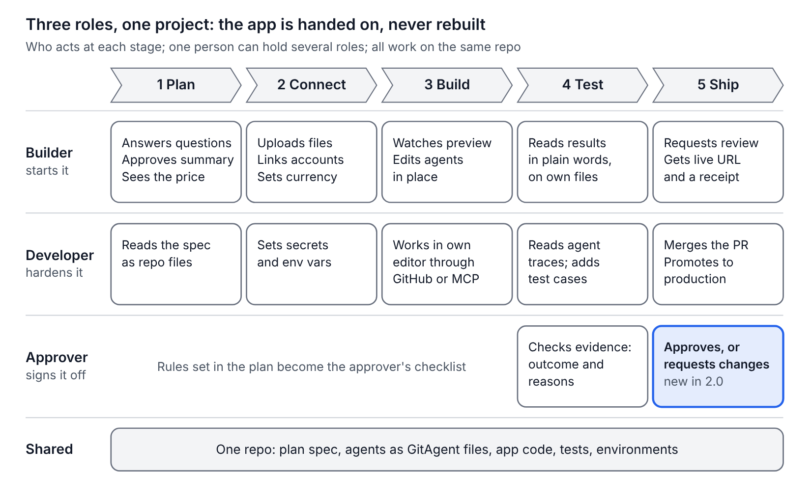
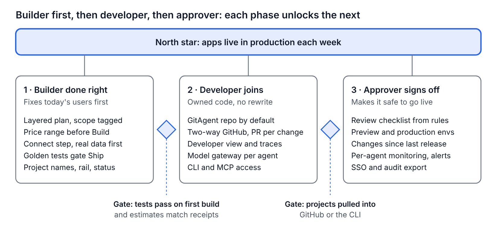

# Architect 2.0 — PRD

11 October 2026 · Dhruv Jain

**Prototype to production in one project.** Architect 2.0 lets a business user or a forward deployed engineer build an agentic app, harden it, get it signed off and run it in the customer's environment, all in one project and without a rewrite. Success is apps that reach production and get used, not apps generated.

## Problem

Agentic apps built by business users stall before production, because the path from prototype to a governed, owned, running app breaks at every handoff. Today's Architect already builds agents that reason well. What fails is the journey around them.

Evidence from our hands-on run of architect.new on 7 Oct, using a loan-triage app and a test lending policy ([discovery doc](DISCOVERY.md)):

| Where it breaks | What we saw | Who it hurts |
| --- | --- | --- |
| The plan has two readers at once | A ~190-line PRD mixes user stories with temperature settings and 13 database tables; scope added silently | Builder can't approve it; developer wants it as files |
| Real data arrives last | The policy knowledge base was created empty and requested three times, mid-build and after; sample data ships inside the app and leaks counts into real mode | Builder, and every user of the app |
| The price comes after the commit | No estimate before Start Building; the build cost $4.99, about a quarter of a $20 plan's monthly credits | Builder |
| Testing checks pages, not the job | Self-checks covered routes and auth; the first PDF upload raised a raw error | Builder and approver |
| The developer path is scattered | Studio is a separate product, GitAgent a beta option inside a question, GitHub an icon in the header | Developer |
| Nobody signs off | No review or approval step before Deploy | Approver |
| Projects have no identity | Random slug names, no status, no sidebar inside a project | Everyone returning to work |

The category has the same gap. App builders (Lovable, Replit, Emergent) stop at the business user, and coding agents (Cursor, Codex, Claude Code) start with a developer who already owns a repo. Nobody owns the handoff, and nobody tests agent reasoning: on the same test case, Lovable reached the right outcome for invented reasons.

## Who it's for

Three roles touch every agentic app that reaches real users. Today's Architect serves the first. 2.0 serves all three in the same project, each with their own view.

|  | Builder | FDE or developer | Approver |
| --- | --- | --- | --- |
| Who | Ops lead, analyst, consultant: knows the process, doesn't code | Forward deployed engineer building for a customer, or the customer's engineer who takes it over | Tech lead, risk or IT: decides what touches real customers |
| Job to be done | Turn a recurring process into a working agentic app this week | Ship a production agentic app for a customer in days, inside the customer's environment, then hand it over | Be confident it is safe and correct before it goes live |
| Pain today | Long technical plan, hidden price, real data requested late, can't tell if it actually works | Code here, agents in Studio, GitAgent set up by hand; every customer starts from scratch; handover means a rewrite or a long document | No review step; can't see what the agents do or how they were tested |
| Their view in 2.0 | Plan summary, preview, plain-language test results | Repo, files, traces, logs, customer workspaces, deploy targets, blueprints, CLI and MCP | Approval checklist, test evidence, changes since last release |
| Success moment | "It worked on my own files, and I know what it costs" | "The customer's team took it over, and I reused it for the next customer" | "I approved it in ten minutes with evidence I trust" |

**Roles, not people.** In a small team or a solo project, one person often holds two or all three roles. Architect 2.0 handles both cases with the same flow:

- **Same person.** At Ship, the builder sees the approver's checklist as a pre-flight self-check, with test evidence and governance rules, then deploys. Nothing waits on anyone.
- **Separate people.** The organisation can require that the approver is not the builder: the maker-checker rule banks already apply to payments. It's one setting, not a different product.

**The organisation sets it up.** In organisation settings, an admin assigns who can build, who can edit code, and who can approve and deploy, and chooses whether the approver must be a different person. Until an admin sets anything, everyone in the organisation can do all three. Either way, the checks themselves never get skipped; only who signs them changes.

Two audiences start projects. The business builder starts from a process they run; the FDE, 2.0's main technical audience, starts from a customer engagement. In an FDE engagement the FDE builds and hardens, the customer's business user becomes the builder for later changes, and the customer's risk or IT lead approves. Everyone is invited into the same project, never sent to another product.

## How we win

We don't try to beat Lovable and Replit at a first demo, or Claude Code, Cursor and Codex at writing code. We win on what comes after the first version: an agentic app tested on the customer's own cases, signed off, and running where the customer needs it.

| Rival | Best at | Where it stops for our users | What Architect 2.0 does |
| --- | --- | --- | --- |
| Lovable | Prompt to a polished web app, fast | Agents are app code with no test of their reasoning: in our run it reached the right outcome for invented reasons. No sign-off before going live | Golden tests check outcome and reason; Connect brings real data first; approval is built in |
| Replit | A full cloud dev environment with an agent that builds and deploys | Made for people comfortable around code; agent internals and errors reach the user | Plain-language progress and errors for builders; the code is one click away for whoever wants it |
| Claude Code and Codex | Strong coding agents, in the terminal and the cloud | Start from a repo the engineer already owns; the agent runtime, knowledge, connectors, approvals and customer deployment are assembled by hand for each customer | The platform underneath: MCP lets them drive Architect, every pull request they open is checked on the customer's golden cases before it merges, and runtime, approvals and deploy targets come with every project |
| Cursor | The AI-first editor | An editor, not a delivery platform: same gaps as above | GitHub sync and MCP bring Architect projects into Cursor; its pull requests are tested on outcome and reason before they merge |

**Why a non-technical builder picks Architect.** Lovable and Replit get you a demo. Architect gets you an app your company will let you put live: the price before you build, your real files from the start, tests in plain language that check the agent's reasons, and an approval your risk team accepts.

**Why an FDE picks Architect.** Coding agents make an FDE faster at code, but most of an engagement isn't code: the customer's data and accounts, agents that must be right for the right reasons, sign-off by the customer, and deployment into their cloud. Architect does that part. It keeps each customer in its own workspace, checks every pull request from their coding agent against the customer's golden cases before it merges, compares models for each agent on those same cases, and turns a delivered app into a versioned blueprint whose improvements roll out to every customer built from it.

## The idea: one project, three views

Every project moves through five visible stages: Plan, Connect, Build, Test and Ship. All three personas work on the same project and the same repo, each in a view made for them, so nothing is rebuilt when the app changes hands.

The builder drives every stage; the developer joins whenever they're invited; the approver acts only at Test and Ship. The governance rules the builder chooses in the plan, such as "cite a clause for every decision", become test checks at Test and the approver's checklist at Ship.

## Requirements and scope

P0 is what 2.0 must ship to deliver "prototype to production"; P1 makes it strong; P2 is later. The last column says how each item appears in our prototype: **Real** works end to end, **Clickable flow** shows the full UX with stand-in data, **Described** lives in the architecture doc only.

| Area | Requirement | Persona | Why (evidence) | Priority | In prototype |
| --- | --- | --- | --- | --- | --- |
| Home | Sign in with Google or email | All | Table stakes | P0 | Real |
| Home | Persistent rail with recent projects; cards show name, description, status (Draft, Preview, Live), last edit, spend, test status | All | No sidebar in a project; slug names; no status | P0 | Real |
| Home | Import an existing project from GitHub or a GitAgent repo | Developer | Assignment asks for import; Lovable can't import | P1 | Clickable flow |
| Home | Customer workspaces: one per customer, each with its own members, connections, deploy target and data boundary; switch between them from the rail | FDE | FDEs run several customer engagements at once; data must never cross customers | P0 | Real |
| Plan | Clarifying questions one at a time, each with a recommended default; cover access, governance, locale | Builder | Architect skipped auth and currency; Lovable skipped governance | P0 | Clickable flow |
| Plan | Layered plan: one-screen summary to approve; full spec saved as files in the repo; added scope tagged "Suggested", off by default | Builder, Developer | 190-line plan for two readers; silent scope creep | P0 | Clickable flow |
| Plan | Project name and one-line description taken from the plan, editable | Builder | Random slugs though the plan named the app | P0 | Real |
| Plan | Cost and time range shown on the Build button, from plan size and past builds | Builder | $4.99 build shown only afterwards | P0 | Clickable flow |
| Plan | Start from a blueprint: reuse a delivered app's plan, agents and golden tests for the next customer, re-pointed at their files and accounts | FDE | Every engagement starts from scratch today | P1 | Clickable flow |
| Plan | Versioned blueprints: publish what improved in the source project as the next version, see every customer project on it across workspaces and which are behind, and roll it out, tested on each customer's own files and live only through their review | FDE | A fix found at one customer never reaches the others; each copy drifts | P1 | Real |
| Plan | Clickable mockup; comments on any element flow back into the plan | Builder | Architect's mockup is static | P1 | Clickable flow |
| Connect | Connect step before Build: knowledge files, accounts (e.g. Gmail), locale and currency; blockers in a pinned to-do list | Builder | Empty knowledge base; upload card scrolled away; $ shown for £ | P0 | Clickable flow |
| Connect | Demo data is a builder-side mode with a visible banner, stripped at deploy | Builder, Approver | Sample-data toggle shipped in the app and leaked counts | P1 | Clickable flow |
| Build | Progress in plain words for builders; raw logs in the developer view; errors translated, with a Fix button | Builder, Developer | Internal errors in chat; raw toISOString toast | P0 | Clickable flow |
| Build | Agent graph editable in place: role, rules, tools, knowledge, model | Builder, Developer | Editing sends you to Studio, a separate product | P0 | Clickable flow |
| Build | Model per agent through one gateway: Claude, GPT, Gemini, open-source | Developer | Assignment: model-agnostic | P1 | Clickable flow |
| Build | Compare models for an agent on its golden tests: pass or fail per case with the reason, cost per case and per month at the customer's volume, speed, where it runs; switch only when every case passes, as a version that can be reverted | FDE, Developer | Model choice is made per customer on cost, data residency and accuracy, and today it is a guess | P1 | Clickable flow |
| Build | Agents in any framework: Lyzr default, GitAgent repo, export to LangGraph or CrewAI | Developer | Assignment: any framework; GitAgent already exists | P1 | Described |
| Build | Studio and GitAgent inside Architect: an Agents page across all projects (model, runs, cost, failures, edit in place), and every project a GitAgent repo with no setup | Builder, FDE | Agents are edited in Studio, a separate product, and GitAgent is set up by hand | P0 | Clickable flow |
| Test | Golden test cases from the user's own files, each with expected outcome and expected reasons; run by default; gate Ship | Builder, Approver | Lovable passed outcome, failed reasons; Architect tested routes only | P0 | Clickable flow |
| Test | Agent trace: what each agent received and returned, per run | Developer, Approver | Lovable's policy agent never saw the trading facts | P0 | Clickable flow |
| Ship | Approver review: checklist built from the plan's governance rules, test evidence, changes since last release, approve or request changes; a self-check when one person holds both roles, a second person when organisation settings require it | Approver | No sign-off step anywhere in the category | P0 | Clickable flow |
| Admin | Organisation settings for roles: who can build, edit code, approve and deploy; optionally require the approver to be a different person. With no setup, everyone can do everything | Org admin | Teams range from solo founders to banks with maker-checker rules | P1 | Clickable flow |
| Ship | Preview and production environments; deploy shows a receipt of cost and version | All | Preview is a dev server; Deploy untested | P0 | Clickable flow |
| Ship | Deploy target per workspace: Architect cloud, or the customer's own cloud account (AWS VPC first), chosen once and used by every deploy | FDE, Approver | Enterprise customers keep data and agents in their own cloud | P1 | Clickable flow |
| Ship | Hand over to the customer: invite their builder, developer and approver, then transfer the project and its repo to their workspace | FDE | Handover today is a rewrite or a long document | P0 | Clickable flow |
| Developer | Two-way GitHub sync: branch per change, pull requests, readable commit messages | Developer | "Update generated app" commits; GitHub only an icon | P0 | Clickable flow |
| Developer | Developer view that works on its own, no outside tool needed: files and editor, Architect's own coding agent, terminal, diffs, tests, logs, environment variables and secrets; edit any file as a version; debug a failed run agent by agent and re-run one case; preview, staging and production settings with promotion | Developer | Code hidden behind the builder flow | P0 | Clickable flow |
| Developer | Optional Architect MCP server (plus CLI): Claude Code, Codex or Cursor can read and change files, agents, models and settings, run golden tests and request review, within org roles; every change is a version (live in the prototype) | Developer | Developers live in coding agents and won't move; Architect joins their chain of work instead | P0 | Real |
| Developer | Pull requests from a coding agent are checked like Architect's own changes: golden tests on outcome and reason, plus the plan's rules; merge blocked while any fails, results posted back for the agent to fix; a merge becomes a version that goes through review | Developer, FDE | Coding agents write code fast, but nothing checks it against the customer's own cases before it merges | P0 | Clickable flow |
| Developer | Agents as an API: endpoints for the whole flow and each agent, keys bound to one environment, OpenAPI spec, code snippets and a Try it console; every call traced and metered | Developer, FDE | Customers want the agent inside their own systems, not only behind Architect's screens | P1 | Real |
| Day two | Monitoring per agent inside Architect, not Studio: runs, cost, failures; alerts | Builder, Developer | App runs drew on builder credits with no breakdown | P1 | Clickable flow |
| Day two | Honest sandbox states: "Waking your app", warm while the builder tab is open | Builder | "Taking a quick mental stretch" reloads | P1 | Clickable flow |
| Collaboration | Live multiplayer editing and comments | All | Nice to have | P2 | Described |

**The** **next** **real slice.** The prototype already runs sign-in, workspaces, invitations, blueprint roll-outs, the MCP server and the agents API for real. The next flow to make real is the golden test itself: a case run against the agent, with a judge checking both the outcome and the clauses cited. It is the feature that most separates 2.0, so it is the one worth proving.

## Non-goals

These are deliberately out of scope for 2.0, so the handoff story stays sharp.

- **A full browser IDE.** The Developer view covers everyday work on its own, including Architect's own coding agent, so a developer without Claude Code or an IDE can still ship. What it won't replicate is a desktop IDE's extensions, debugger and local tooling; for that, GitHub sync and MCP connect the developer's own setup.
- **Native mobile apps.** Emergent leads there; Architect's buyers want internal web tools.
- **A new pricing model.** 2.0 shows estimates and receipts on the existing credit system; changing what credits cost is a business decision, not this PRD.
- **Re****tiring Studio or GitAgent for today's users****.** 2.0 covers what users did in them, so nobody has to leave Architect; Studio's runtime and the GitAgent format run underneath. Moving existing Studio users over is a separate plan.
- **Self-serve on-premise install.** Apps deploy into a customer's cloud account; installing Architect itself on-premise stays a sales-led enterprise deployment.
- **Our own models.** Architect routes to existing providers through the gateway.

## Success metrics

The north star is **apps live in production** **and used each week**: deployed, tests passing, approved, and used at least once that week. Three supporting measures: time from first prompt to a working preview on real data, golden-test pass rate on the first build, and the share of previews that reach Live, solo or team.

## Release plan

Ship in three phases, builder first, because builders are Architect's users today and golden tests are the foundation every later phase stands on. Each phase opens only when the one before it proves itself.

The gate after phase 1 checks that the builder experience is trustworthy: tests pass on the first build and estimates match receipts. The gate after phase 2 checks that the code is really owned: projects get pulled into GitHub or the CLI, whether by a solo founder or a team's developer. Targets for both depend on Lyzr's current baselines. Every P0 item ships within 2.0; the phases only set the order. The prototype shows all three phases as one product.

## Risks and open questions

| Risk | Mitigation |
| --- | --- |
| Three views make the product feel heavier | Open in the view that matches the user's role; the others are one click away, never shown by default |
| A wrong cost estimate breaks trust faster than no estimate | Show a range, label it an estimate, and compare it with the receipt; tune from real build history |
| Users won't have files for golden tests | Suggest cases from the plan, label them "synthetic", and nudge for one real file before Ship |
| The approval step feels like bureaucracy to small teams | When the builder is also the approver, Ship shows the same checklist as a quick self-check; a second approver is required only when the organisation's admin turns that on |
| Keeping sandboxes warm raises infrastructure cost | Warm only while a builder tab is active; snapshot and restore otherwise (architecture doc) |
| Developer and approver needs are untested with real users | Run the planned conversations before committing build effort to P1 developer features |

**Decisions this PRD rests on**

- 2.0 targets FDEs as its technical audience, alongside non-technical builders.
- Studio and GitAgent move inside Architect 2.0: users should never have to go to Studio or set up GitAgent by hand.
- Success is apps that reach production and get used. The product comes first, so this PRD keeps metrics light.
- The credit model stays as it is today; 2.0 adds estimates before work starts and receipts after.
